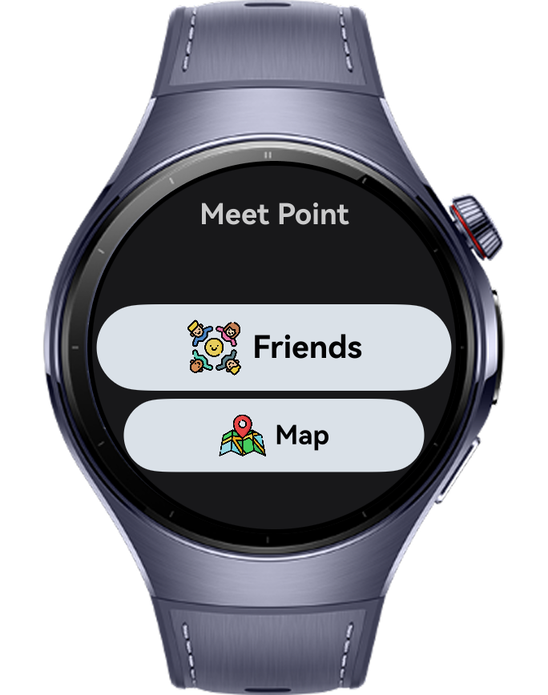
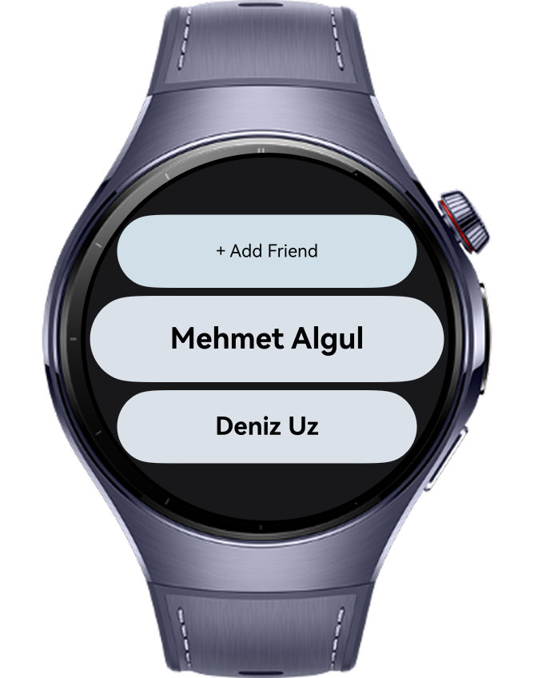
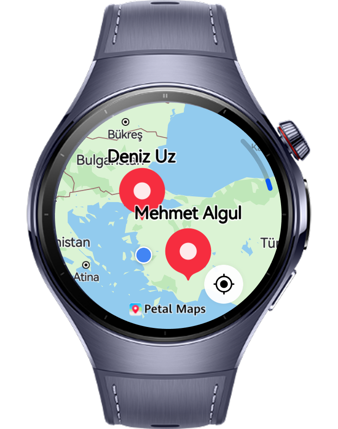
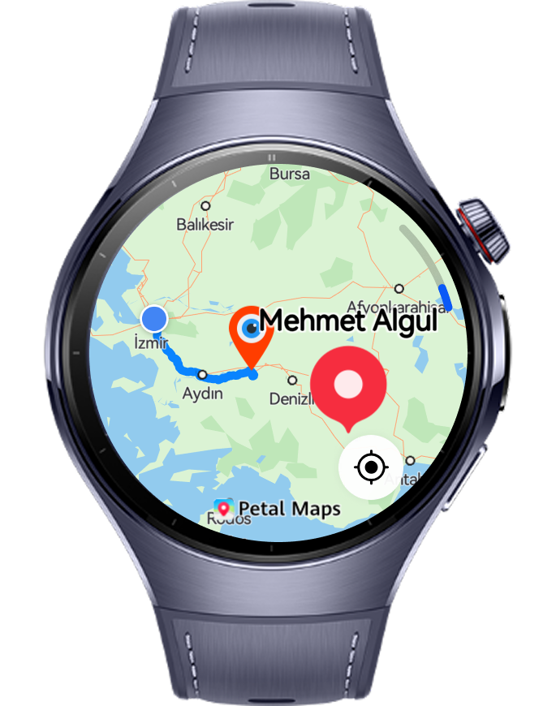

> **Note:** To access all shared projects, get information about environment setup, and view other guides, please visit 

# Meet Point

Meet Point is a wearable application that allows users to see the most optimal common meeting point with their friends anywhere in the world and create a route to that location.

# Preview

<div>
  
  
  

</div>

# Use Cases

1. In the first step, users can add any friends they want to the app by their names.
2. In addition, users can edit how they have saved their friends in the app.
3. By using the Map page, users can see where their friends are and view the most optimal meeting point by tapping on the friends they want to meet with.
4. The application calculates the closest common location for both parties and generates a route to that place for the user.

# Technology

## Stack

- **Languages**: ArkTS, ArkUI
- **Frameworks**: HarmonyOS 5.1.0(18)
- **Tools**: DevEco Studio Vers 5.1.0.828SP1,
- **Libraries**: @kit.ArkUI, @kit.MapKit, @kit.LocationKit

## Required Permissions

- `ohos.permission.LOCATION`
  > Required to get location information.
- `ohos.permission.APPROXIMATELY_LOCATION`
  > Required to get approximate location.
- `ohos.permission.LOCATION_IN_BACKGROUND`
  > Required to use location services in background
  
# Directory Structure

```
entry/src/main/ets/
├───data
│       MainMenuItems.ets
│
├───entryability
│       EntryAbility.ets
│
├───entrybackupability
│       EntryBackupAbility.ets
│
├───pages
│       AddFriendPage.ets
│       FriendPage.ets
│       FriendsPage.ets
│       Index.ets
│       MapPage.ets
│       SplashScreen.ets
│
├───types
│       Friend.ets
│       Location.ets
│       MainMenuItem.ets
│
└───utils
        FriendUtils.ets

```

# Constraints and Restrictions

## Suported Devices

- Huawei Watch 5

## Limitations

- Application is not working on previewer or simulators
- Users need to apply location permissions and enable location in smart watch

# License

**Meet Point** is distributed under the terms of the MIT License
See the [LICENSE](/LICENSE) for more information.